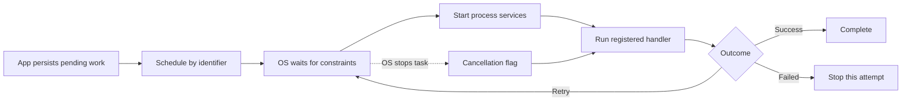
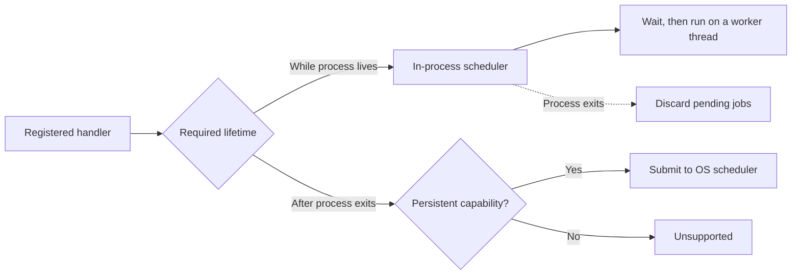

# Background work

Schedule short tasks that the operating system can run after a Day app leaves the foreground. Use it for retrying a sync, refreshing cached data, or finishing queued work that can tolerate delays.

Choose between two separate schedulers:

| Scheduler | Lifetime | Available on |
| --- | --- | --- |
| `schedule` / `cancel` | The OS retains requests and can start the app's services after its process exits. | iOS and Android |
| `in_process::schedule` / `in_process::cancel` | Jobs stay in memory and disappear when the process exits. | macOS, Windows, Linux, iOS and Android |

`capabilities()` reports each independently. Persistent scheduling never silently falls back to in-process work. The persistent scheduler uses iOS `BGTaskScheduler` and Android WorkManager. Scheduling remains optional; Day core supplies the process startup hook that lets handlers load before any UI exists.

## Register a handler

Task identifiers are stable names, registered at link time:

```rust
use day_part_background::{Context, Outcome, Schedule};

day_part_background::register_task!("dev.example.refresh", refresh);

fn refresh(context: Context) -> Outcome {
    if context.is_cancelled() { return Outcome::Retry; }
    // Process a bounded chunk of persisted work. Check cancellation between chunks.
    // Return Retry for a transient failure; Failed for a permanent failure.
    Outcome::Success
}

async fn schedule() -> Result<(), day_part_background::Error> {
    let mut request = Schedule::new("dev.example.refresh");
    request.requires_network = true;
    request.interval_secs = Some(15 * 60);
    day_part_background::schedule(&request).await
}
```

Handlers run on a worker thread. They cannot read a page's signals or require an open window. Persist inputs before scheduling, make writes safe to repeat, and check `Context::is_cancelled()` frequently. Cancellation is cooperative; it cannot terminate arbitrary Rust code.



## Scheduling rules

- A schedule replaces pending work with the same identifier. Android also cancels an executing instance; a handler may take time to observe cancellation.
- Repeats request an interval of at least 15 minutes. The OS chooses the actual run time; this API is not an alarm or an exact timer.
- `delay_secs` is a minimum delay. Network and charging constraints can delay execution further.
- Payloads are UTF-8 strings of at most 4,096 bytes. Store larger data separately and pass an identifier.
- `cancel(identifier)` removes pending work and asks active handlers to stop. A task that completed before cancellation can still have written results.
- `run_now` invokes the handler in the caller's thread for diagnostics. It does not test background execution.

## Platform setup

| Platform | Scheduling | Setup and limits |
| --- | --- | --- |
| iOS/UIKit | `BGProcessingTaskRequest` | List identifiers in `BGTaskSchedulerPermittedIdentifiers` and add `processing` to `UIBackgroundModes`. The OS may defer work for a long time. Repeating tasks resubmit before execution. |
| Android/Material | WorkManager | The package contributes WorkManager and manifest permissions. WorkManager persists requests and can start the Rust handler without an Activity. Force-stopping an app prevents execution until the user opens it again. |
| macOS, Windows, Linux | In-process only | `capabilities().in_process` is true; persistent scheduling returns `Error::Unsupported`. No startup registration is installed. |
| Web, HarmonyOS | Unavailable | Both scheduling capabilities are false. `run_now` can still test a registered handler on native hosts. |

For iOS, add these keys to `platform/ios/Runner/Info.plist`:

```xml
<key>BGTaskSchedulerPermittedIdentifiers</key>
<array><string>dev.example.refresh</string></array>
<key>UIBackgroundModes</key>
<array><string>processing</string></array>
```

System scheduling does not guarantee eventual execution. Keep a foreground sync path for work users need immediately. This package does not provide Android foreground services, iOS background transfers, or continuous location tracking.

## Work while the app stays open

Use the same registered handlers for a delayed refresh or retry in a running app:

```rust
let mut request = day_part_background::Schedule::new("dev.example.refresh");
request.delay_secs = 30;
day_part_background::in_process::schedule(&request)?;
// Cancels only the in-process job, leaving any OS schedule with this identifier alone.
day_part_background::in_process::cancel(&request.identifier)?;
# Ok::<(), day_part_background::Error>(())
```

In-process scheduling does not keep a suspended app running. Network and charging constraints return `Error::Unsupported`; they are never ignored. Repeats wait at least the requested interval after a handler returns. `Retry` waits 15 minutes; `Failed` ends the schedule. Pending waits wake promptly on cancellation. Running handlers must cooperate, so a replacement may begin before its predecessor returns. At most 64 worker threads can be active, including cancelled handlers that have not returned.



## Demo and checks

[Background Lab](../demo/) records a persistent completion count. Schedule a task, leave the app, then return and refresh the count. Its separate **Run handler now** button tests the handler without the OS scheduler.

```sh
cargo test
cargo clippy --all-targets -- -D warnings
cd demo
day launch -t android-material --script dayscript/demo.yaml
day launch -t ios-uikit --script dayscript/demo.yaml
```
